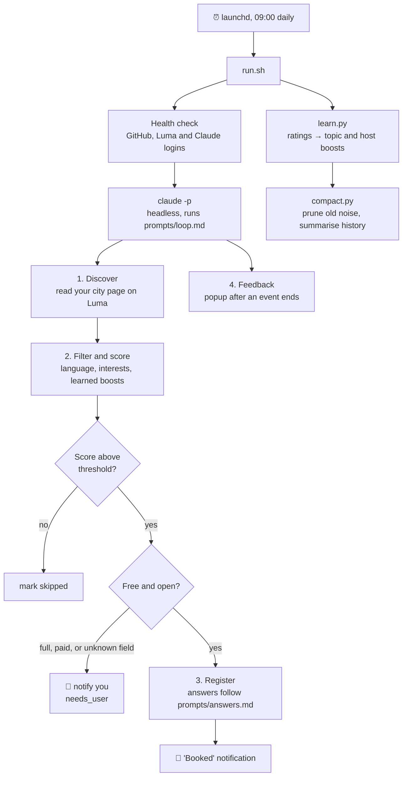
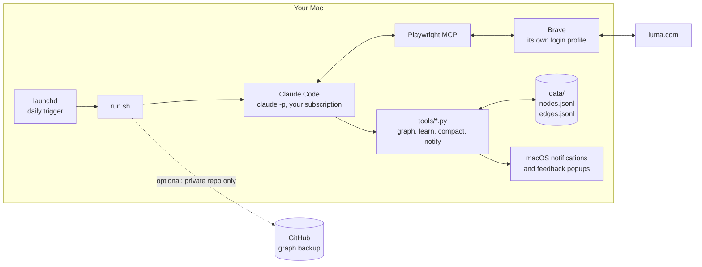
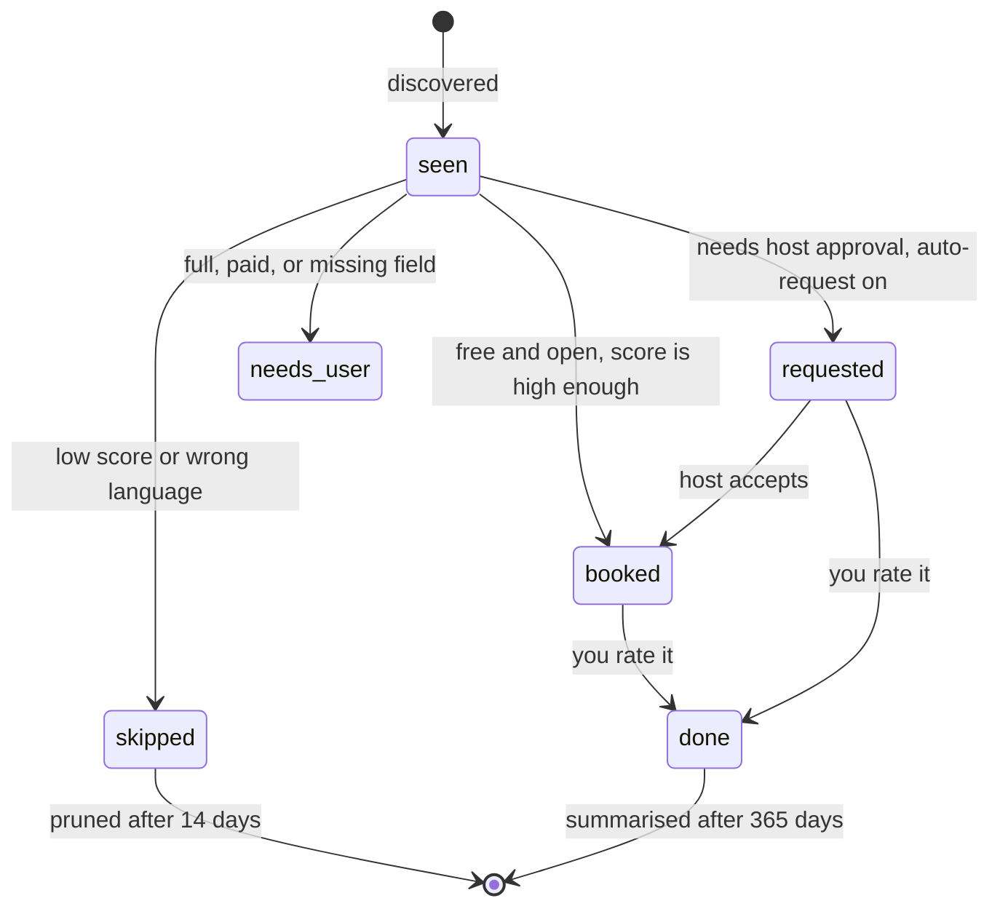
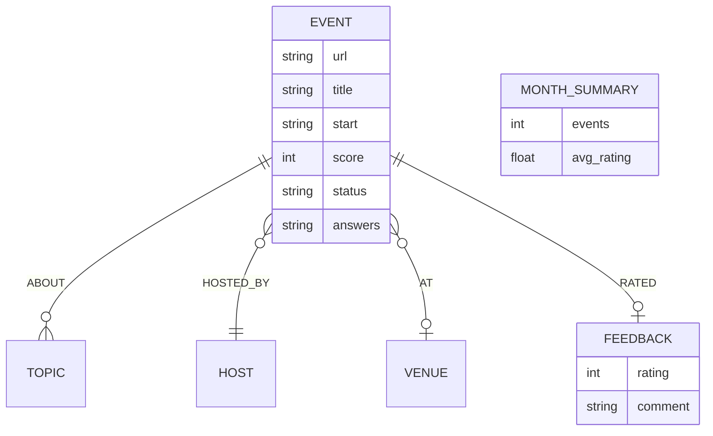

# 🎟️ Luma Event Agent

**An agent that finds the right [Luma](https://luma.com) events for you, signs you up, asks how it went, and gets better at picking the next ones.**

It runs once a day on your own Mac, uses your existing Claude Code subscription, and keeps its memory in two small text files. No server, no database, no extra API key, no monthly bill.

```
discover  →  score  →  book  →  ask for feedback  →  learn  →  repeat
```

---

## Why this exists

Luma is full of good meetups, but finding them means scrolling a city page every few days, and the best ones fill up fast. Signing up is repetitive too: the same name, role and "why do you want to attend?" over and over.

This project hands that loop to an agent:

| Problem | What the agent does |
|---|---|
| "I forget to check Luma" | Checks your city page every day |
| "Most events aren't for me" | Scores every event against your interests and skips the rest |
| "Sign-up forms are tedious" | Fills them in from your public LinkedIn profile |
| "I never remember what I liked" | Asks for a 1-5 rating after each event and stores it |
| "Recommendations never improve" | Turns your ratings into boosts for topics and hosts you actually enjoyed |

The design rule throughout is **keep the logic simple and fast to implement**. The whole thing is a shell script, a few small Python files and one prompt.

---

## How a daily run works



Each run takes roughly **3 to 5 minutes**. Almost all of it is the browser loading pages.

---

## Architecture



| Piece | Role | Why this choice |
|---|---|---|
| **launchd** | Wakes the agent daily | Built into macOS, zero cost |
| **Claude Code, headless** | The brain: reads pages, decides, fills forms | Uses the subscription you already pay for |
| **Playwright MCP + Brave** | The hands: a real browser with its own login | Your normal browser is untouched |
| **JSONL files** | The memory: a graph in plain text | Diffable, greppable, no database to run |
| **macOS notifications** | The voice: alerts and feedback popups | No email password needed |

**Cost: $0 extra.** The one trade-off is that it only runs while your Mac is awake.

---

## What a booking looks like

Every event moves through a small, explicit lifecycle. The status is stored in the graph, so each run picks up exactly where the last one stopped.



---

## The knowledge graph

Everything the agent knows is a small graph stored as two append-only text files:



- **`data/nodes.jsonl`**: one JSON object per node. The latest line for an id wins.
- **`data/edges.jsonl`**: one JSON object per relation.

**Learning.** `tools/learn.py` turns your ratings into a boost per topic and host: `(average rating − 3)`, capped at ±3. A topic you rate 5 stars gets +2 on future scores. Topics you keep rating highly that aren't in your keywords are suggested to you.

**Compaction.** The agent never stores all of Luma. Once a day `tools/compact.py`:

1. collapses duplicate lines,
2. drops events you only saw or skipped, 14 days after they pass,
3. folds events older than a year into one `month:YYYY-MM` summary,
4. removes topics and hosts nothing points to anymore.

Booked, requested and upcoming events are never deleted.

**See it.** `python3 tools/viz.py` builds a self-contained, interactive page: drag nodes, zoom, filter by status, search, click an event for its details and relations.

---

## Setup

**Requirements:** macOS, [Claude Code](https://claude.com/claude-code) logged in, Node.js (for `npx`), Python 3, Brave.

```bash
git clone https://github.com/Sourish0911/luma-event-agent && cd luma-event-agent
./setup.sh                 # creates your local, gitignored config from the templates
$EDITOR interests.json     # your city, keywords, limits
$EDITOR profile.json       # your public LinkedIn URL
```

Log into Luma once in the agent's **own** browser profile, then quit that window with **Cmd+Q** so the login is saved:

```bash
open -na "Brave Browser" --args --user-data-dir="$HOME/.luma-agent/brave-profile" https://luma.com/signin
```

Test it without booking anything, then schedule it:

```bash
./run.sh --dry
cp com.user.luma-agent.plist ~/Library/LaunchAgents/
launchctl load ~/Library/LaunchAgents/com.user.luma-agent.plist
```

### Configuration (`interests.json`)

| Key | Meaning | Example |
|---|---|---|
| `city_url` | Luma city page to scan | `https://luma.com/your-city` |
| `keywords` | Interest → weight | `{"AI": 3, "startup": 2}` |
| `threshold` | Minimum score (0-10) to book | `6` |
| `max_bookings_per_day` | Safety cap per day | `1` |
| `auto_request_approval` | Also submit requests for host-approval events | `false` |
| `event_language` | `english_or_bilingual` skips Japanese-only pages | `english_or_bilingual` |
| `retention` | Days before pruning noise / archiving history | `{"noise_days": 14, "archive_days": 365}` |

---

## Safety model

Letting an agent loose on a browser deserves care, so the defaults are conservative:

- 🛡️ **Free events only.** Paid events, full events and waitlists go to you as a notification.
- 🛡️ **Never answers sensitive fields:** phone, address, ID, visa, payment, health. It stops and tells you instead of guessing.
- 🛡️ **Never invents facts.** Answers use only your public profile and your interest list. See [`prompts/answers.md`](prompts/answers.md).
- 🛡️ **Web pages are data, not instructions.** Text on an event page cannot give the agent orders.
- 🛡️ **Explicit tool allowlist** in `run.sh` instead of skipping permissions. `rm`, `git`, `curl`, `sudo` and similar are blocked.
- 🛡️ **Credential watchdog.** `tools/healthcheck.py` warns you before a GitHub, Luma or Claude login expires.
- 🛡️ **Capped.** `max_bookings_per_day` and `--max-turns` stop runaway runs.

## Privacy

Your profile, interests, graph and logs are **gitignored**, so they never leave your machine. To back the graph up, point `origin` at **your own private** repository and run `touch .sync-graph`. Never do that on a public remote: the graph records which events you attended and what you thought of them.

---

## Repository layout

```
run.sh                     the whole daily loop, a short shell script
prompts/loop.md            what the agent does, step by step
prompts/answers.md         how it answers registration questions
tools/graph.py             the graph "database" (about 70 lines)
tools/learn.py             ratings → interest boosts
tools/compact.py           daily pruning and archiving
tools/notify.py            macOS notifications and feedback popups
tools/healthcheck.py       credential expiry watchdog
tools/viz.py               interactive graph viewer
setup.sh                   creates your local config
*.template.*, *.example.*  machine-independent config templates
```

## Limitations

- macOS only (launchd and `osascript` notifications).
- Runs only while the Mac is awake. A run missed while it's asleep happens when it wakes; one missed while it's off is skipped.
- Luma's page layout can change, and the agent reads pages like a person would. Occasional misreads are possible, so keep `max_bookings_per_day` low at first.
- LinkedIn often blocks automated reads. The agent caches your profile and refreshes it rarely.

## License

MIT, see [LICENSE](LICENSE).
